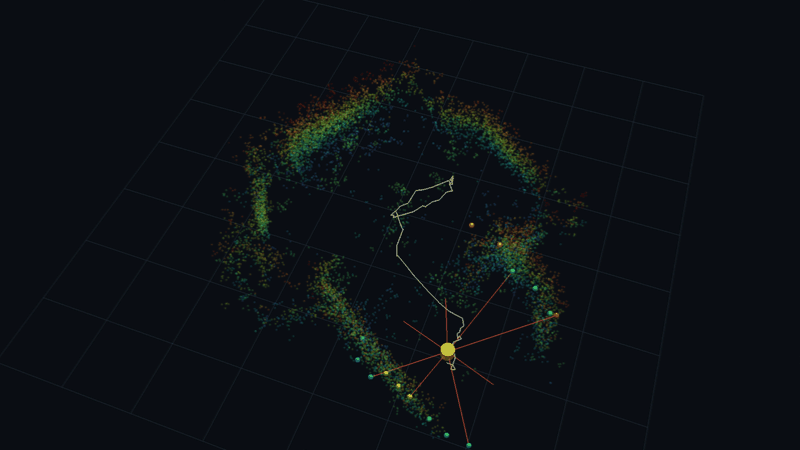
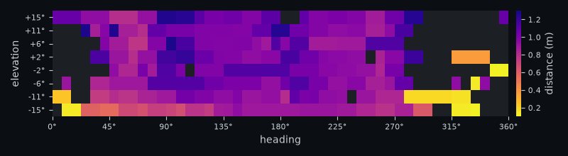
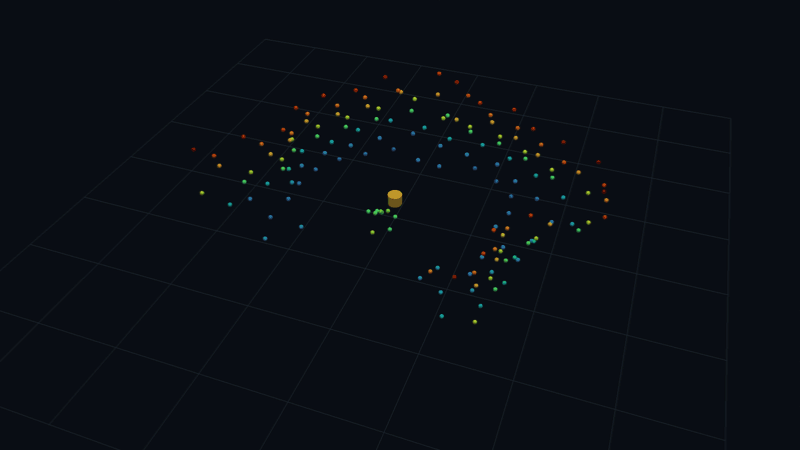
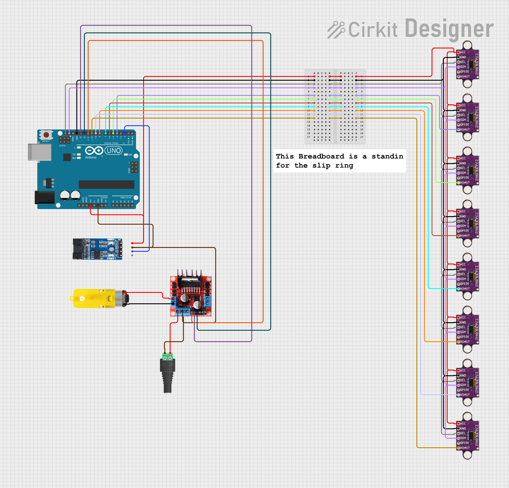
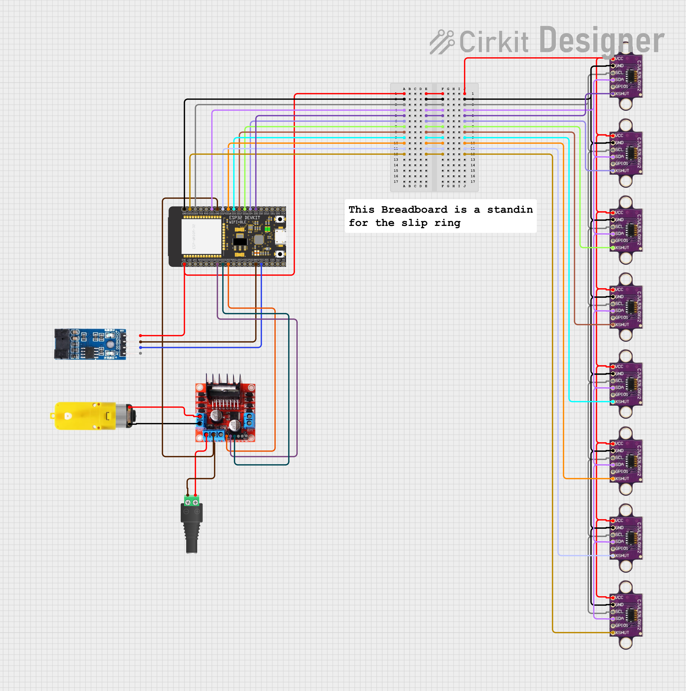

# Arduino 3D LiDAR: DIY 360° Scanner with VL53L0X Sensors

[](LICENSE)
[](pyproject.toml)
[](#firmware-arduino-uno-and-esp32)

A low-cost, 3D-printed rotating LiDAR scanner built from eight **VL53L0X time-of-flight sensors**, an **Arduino Uno or ESP32**, and a slip ring. It sweeps a full 360° at about 2 Hz with a ±15° vertical field of view and streams the scan over USB serial. Python tools record the scans and show them as a 3D point cloud, live or from a recording.

| Rotating sensor head | Replay inside the registered map |
| :---: | :---: |
|  |  |

It produces a coarse point cloud, suitable for experiments, teaching, and rough room-scale mapping. It does not replace a commercial LiDAR. The parts for one unit cost about **€130** from Amazon Germany, or about **€100** if you already have filament, screws and jumper wires (see [Bill of materials](#bill-of-materials)).

**No hardware yet?** The repository includes a sample recording, so you can try the viewer first:

```bash
uv sync
uv run python python-receiver-code/offline_visualization.py
```

## Contents

- [Specifications](#specifications)
- [How it works](#how-it-works)
- [Bill of materials](#bill-of-materials)
- [Build](#build)
- [Wiring](#wiring-arduino-uno-and-esp32)
- [Firmware](#firmware-arduino-uno-and-esp32)
- [Eight VL53L0X sensors on one I2C bus](#running-eight-vl53l0x-sensors-on-one-i2c-bus)
- [Python tools](#python-tools-capture-and-visualize-point-clouds)
- [Data format and serial protocol](#data-format-and-serial-protocol)
- [Limitations](#limitations)
- [FAQ](#faq)
- [Built one? Contributing](#built-one-contributing)
- [Related projects](#related-projects)

## Specifications

Measured on the bundled sample recording (`data/sequences/01`):

| Property | Value |
|---|---|
| Channels | 8 × VL53L0X, vertical angles evenly spaced from +15° to −15° |
| Horizontal coverage | 360°, rotating at a target of 2 Hz (500 ms per revolution, closed-loop) |
| Points per revolution | ~200 raw, ~140 with a valid return |
| Horizontal resolution | ~25 samples per channel per revolution (~14°) |
| Range of valid returns | 0.15–1.2 m for 90% of the sample's points; readings are clamped at 3 m |
| Angle reference | 15-tooth encoder disc with one gap for the zero position |
| Host link | USB serial, 115200 baud, 36-byte binary packets |
| Controllers | Arduino Uno (ATmega328P) or ESP32 (Arduino core 3.x) |
| Parts cost | ~€130 per unit, ~€100 without filament, screws and jumper wires (Amazon Germany, 2026) |

## How it works

Eight VL53L0X sensors sit on a rotating head, each tilted to a different elevation angle. A DC motor turns the head through a rubber-band drive, and a slip ring carries power and I²C through the rotating joint. An optical speed sensor reads a toothed encoder disc to measure the azimuth angle. A hardware timer interpolates the angle between teeth. The firmware also adjusts the motor PWM once per revolution to hold the speed at 2 Hz.

Each reading is a distance plus the azimuth and elevation of its channel. The Python tools convert these spherical coordinates to Cartesian XYZ.

|  |
| :---: |
| *Mounting angles of the eight sensor channels* |

Unrolled, one revolution is a small range image: one row per channel, one column per heading. This is what the scanner actually measures:

|  |
| :---: |
| *Range image of the sample recording, one revolution per frame (dark cells: no return)* |

The sample was recorded on a slowly moving rover inside a small enclosure. Aligning the revolutions to each other (scan matching) recovers that motion and gives a map of the surroundings. The replay at the top of this page plays each revolution at the real 2 Hz inside that map. The red lines are the eight beams, which point in eight directions and rotate together. Below, the same map is built up revolution by revolution:

|  |
| :---: |
| *Map built from the sample recording* |

Even at this resolution, the output works for simple tasks such as building an occupancy grid map:

|  |
| :---: |
| *Occupancy grid map built from the scanner's output (1× speed)* |

## Bill of materials

Prices are rounded 2026 prices for one unit from Amazon Germany, including 19% VAT. They vary by country and seller. The links simply point to the parts I used, or to a search for them where individual listings change too often to link directly. I have no affiliation with Amazon or any seller, and none of the links are affiliate links. If you have good sources for other countries, please open an issue or PR.

| Part | Amount | Unit cost | Cost | Link |
|------|-------:|----------:|-----:|------|
| VL53L0X breakout board<sup>1</sup> | 8 | €2.85 | €22.80 | [Amazon](https://amzn.eu/d/0hz0XM7l) |
| 12-wire slip ring<sup>2</sup> | 1 | €17.99 | €17.99 | [Amazon](https://amzn.eu/d/00M42s6L) |
| Arduino Uno R3, compatible<sup>3</sup> | 1 | €13.99 | €13.99 | [Amazon](https://amzn.eu/d/07YWSVjQ) |
| 9 V DC power supply<sup>4</sup> | 1 | €7.99 | €7.99 | [Amazon](https://amzn.eu/d/0caRRXWE) |
| 6204-2RS ball bearing<sup>5</sup> | 1 | €9.99 | €9.99 | [Amazon](https://amzn.eu/d/0daEw33N) |
| L298N motor driver | 1 | €4.99 | €4.99 | [Amazon](https://amzn.eu/d/0iNRK78D) |
| TT gear motor, 3–6 V | 1 | €9.99 | €9.99 | [Amazon](https://amzn.eu/d/05aKF0C8) |
| LM393 speed sensor module | 1 | €7.99 | €7.99 | [Amazon](https://amzn.eu/d/0ivhba8L) |
| USB cable<sup>6</sup> | 1 | €4.19 | €4.19 | [Amazon](https://amzn.eu/d/00ykSAmE) |
| PLA filament<sup>7</sup> | 131 g | – | €12.99 | [Amazon](https://amzn.eu/d/0cBkmGoz) |
| M3 screws<sup>7</sup> | ~15 | – | €7.88 | [Amazon](https://amzn.eu/d/02Wt2UgE) |
| Jumper wires<sup>7</sup> | ~40 | – | €6.99 | [Amazon](https://amzn.eu/d/0aRaSrCN) |
| O-ring or rubber band, zip ties<sup>8</sup> | – | – | €1.00 | – |
| **Total** | | | **€128.78** | |

1. Must expose the `XSHUT` pin, which the firmware uses to assign the I²C addresses.
2. Carries power, I²C and the `XSHUT` lines to the rotating head. The ESP32 wiring uses all 12 wires.
3. Or an [ESP32-WROOM dev board](https://amzn.eu/d/0dcB7aNT) for about €9.99, you will need a different USB cable to flash this one, see 6.
4. Powers the motor. Anything from 7 to 9 V DC works, for example a 2S Li-ion pack or a 9V battery; the L298N drops about 2 V.
5. 20 × 47 × 14 mm (bore × OD × width), sealed on both sides; it supports the rotating head in the base top. The link is the LFD 6204 2RS used in the prototype. Any 6204-2RS or 6204-ZZ fits.
6. USB-B for the Uno; micro-USB or USB-C for most ESP32 boards.
7. Cost of a full pack (a 1 kg spool for the filament). One build uses only a small part of it; without these three rows, the parts cost about €100.
8. The O-ring or rubber band is the drive belt between the motor gear and the head. Zip ties hold the motor plate.

Several parts only come in packs (sensors in 5s or 10s, motors in 4s, LM393 modules in 5s), so if you start from nothing, expect to spend more than the total above and keep the spares. Most of these parts are also available on AliExpress, which is generally cheaper but has longer shipping times; I don't link specific listings there. A 3D printer, a soldering iron (most VL53L0X breakouts ship with loose headers) and basic hand tools are not included.

## Build

1. **Print the parts** in [`stl-files/`](stl-files/): base top and bottom, pillars, sensor head, encoder disc, and small gear. PLA at 0.2 mm layer height with 20% infill and supports is fine. All parts fit together on a 220 × 220 mm bed and take about 21 hours and 131 g of filament.
2. **Assemble and wire** following [`stl-files/assembly-instructions.md`](stl-files/assembly-instructions.md) and the [wiring diagrams](#wiring-arduino-uno-and-esp32) below. The assembly guide covers print orientation, mechanical assembly, pin tables for both boards, a pre-power checklist, and bring-up troubleshooting.
3. **Flash the firmware** (see [Firmware](#firmware-arduino-uno-and-esp32)), power the motor, and check the output with the [live viewer](#run).

> [!CAUTION]
> The VL53L0X `XSHUT` pin is not 5 V tolerant. On an Arduino Uno, never drive it HIGH directly. The firmware only pulls it LOW or releases it as an input.

## Wiring (Arduino Uno and ESP32)

All eight VL53L0X sensors share one I²C bus (SDA, SCL) and 3.3 V power. Each sensor also gets its own `XSHUT` line, which the firmware uses to [give each sensor its own address](#running-eight-vl53l0x-sensors-on-one-i2c-bus). The L298N drives the TT motor from the 9 V supply, and the LM393 module reads the encoder disc. In the diagrams, the breadboard in the middle stands in for the slip ring. Click a diagram for the full-size image. The pin tables are in the [assembly guide](stl-files/assembly-instructions.md#3-arduino-uno-wiring).

| Arduino Uno | ESP32-WROOM |
| :---: | :---: |
|  |  |

## Firmware (Arduino Uno and ESP32)

| Board | Sketch |
|-------|--------|
| Arduino Uno | [`arduino-code/write_byte_output_batchwise.ino`](arduino-code/write_byte_output_batchwise.ino) (bundles `TimerOne`) |
| ESP32 | [`esp32-code/write_byte_output_batchwise_esp32/`](esp32-code/write_byte_output_batchwise_esp32/) (ESP32 Arduino core 3.x timer API) |

1. Install the **VL53L0X library by Pololu**: *Sketch → Include Library → Manage Libraries…*, then search for `VL53L0X`.
2. Open the sketch for your board and upload it.
3. Power the motor driver from its own supply. USB alone cannot power both the motor and the board reliably, especially on the ESP32.

If the point cloud looks mirrored or smeared, the motor is probably spinning the wrong way. Swap the motor driver inputs `in1` and `in2`.

## Running eight VL53L0X sensors on one I2C bus

Every VL53L0X starts up at the same I²C address, `0x29`, so several of them on one bus would answer at once. The address can be changed in software, but the sensor forgets it on every power-up. The firmware therefore wakes the sensors one at a time in `setup()`:

1. Pull the `XSHUT` lines LOW, which holds those sensors in reset. On the Uno, one sensor has no `XSHUT` line and stays awake.
2. Give the one awake sensor a new address with `setAddress()` from the Pololu library.
3. Release the next `XSHUT` line and wait 10 ms for that sensor to boot. It comes up at `0x29`.
4. Repeat until all sensors are awake. The last one keeps `0x29`, so the eight sensors use addresses 41 to 48 (`0x29`–`0x30`).

The `XSHUT` lines are released by switching the pin to an input, never by driving it HIGH, because the pin is not 5 V tolerant. The breakout's own pull-up then brings it to 3.3 V. After that, every sensor runs in continuous mode with a 20 ms timing budget, so all eight measure in parallel, and the loop only reads the latest result from each one.

The same approach works for any number of VL53L0X (or VL53L1X) sensors on an Arduino or ESP32, as long as each one has its own `XSHUT` pin.

## Python tools: capture and visualize point clouds

The tools in [`python-receiver-code/`](python-receiver-code/) need Python 3.13+, and use [VisPy](https://vispy.org/) with a [GLFW](https://www.glfw.org/) window for rendering.

| Script | What it does |
|--------|--------------|
| `offline_visualization.py` | Plays back recorded `.npy` frames. Uses the bundled sample by default. |
| `receive_data.py` | Reads the serial stream and saves one `.npy` file per revolution |
| `live_visualization.py` | Shows the point cloud live from the serial stream. Can also save frames (`--save`). |
| `render_readme_media.py` | Registers a recording into a map and renders the README images and GIFs (map, replay, range strip). Needs the `media` dependency group. |

### Install

With [uv](https://docs.astral.sh/uv/) (recommended; it fetches Python 3.13 if needed):

```bash
uv sync
```

With pip:

```bash
python3.13 -m venv .venv
source .venv/bin/activate   # Windows: .venv\Scripts\activate
pip install .
```

### Run

Run the commands from the repository root. If you installed with pip, replace `uv run python` with `python` inside the activated environment.

Play back the bundled sample recording. You don't need the hardware for this:

```bash
uv run python python-receiver-code/offline_visualization.py
```

View a live scan from the scanner (use `COM3` or similar on Windows):

```bash
uv run python python-receiver-code/live_visualization.py --port /dev/ttyUSB0
```

Record scans to `data/sequences/<timestamp>/lidar_points/` without a viewer:

```bash
uv run python python-receiver-code/receive_data.py --port /dev/ttyUSB0
```

Turn a recording into a map, a replay GIF and a range strip like the ones above. This needs the optional `media` group (`uv sync --group media`, or `pip install --group media` with pip 25.1+). It renders off-screen, so no display is needed. Point it at your own recording, and the results go to a `media/` folder next to it (here `data/sequences/<timestamp>/media/`):

```bash
uv run python python-receiver-code/render_readme_media.py --path data/sequences/<timestamp>/lidar_points
```

Without `--path`, it renders the bundled sample into `Images/` (the images in this README). Mapping works best when the scanner moves slowly on a flat floor and sees walls within about 1.2 m. On short recordings, or if the map looks empty, lower `--min-support`.

Useful options:

- `--path DIR_OR_FILE` (offline, media): use a different recording
- `--only map|replay|range` (media): render one variant only; repeat to pick several
- `--out-dir DIR` (media): choose where the images go
- `--min-support N` (media): keep map points seen by at least N other revolutions (default 3)
- `--replay-revolutions N` (media): length of the replay GIF (default 40, at 2 per second)
- `--fps N` (offline): set the playback speed
- `--point-size PX`: set the size of the drawn points
- `--frame-limit N` (capture): stop after N revolutions
- `--keep-invalid` (viewers): also draw points with no return. By default, readings of 0 mm or clamped to 3000 mm are hidden, because they are not real surfaces.

Run any script with `--help` to see all options.

### Tests

```bash
uv run pytest
```

The tests check the packet parser, frame assembly, coordinate conversion, and scan registration. They need no hardware and no OpenGL.

## Data format and serial protocol

**Recorded frames** are NumPy `.npy` files. Each file holds one revolution as an `(N, 3)` `int32` array of `distance_mm, azimuth_deg, channel`. Channel 0 is the top sensor at +15° and channel 7 the bottom one at −15°. The files store the raw sensor readings: the per-channel azimuth offsets and the conversion to XYZ are applied when the frames are loaded (`convert_to_cartesian` in `offline_visualization.py`).

**Serial packets** are 36 bytes:

```text
FE FD | 8 × [angle_hi angle_lo dist_hi dist_lo] | FC FB
```

All values are big-endian `uint16`. A packet whose 32-byte payload is all `0xFF` is a **sync packet**: the encoder has passed the zero position and a new revolution begins.

## Limitations

- **Sparse:** about 140 valid points per revolution. That's enough for occupancy maps, but not for detailed 3D reconstruction.
- **Short range:** the VL53L0X is specified to 2 m, and is often less in bright light or on dark surfaces.
- **Angle accuracy:** between encoder teeth, the angle is interpolated from a fixed timer that assumes exactly 2 Hz. Any speed change shows up as angular error. The sample recording also has spurious encoder ticks, each of which turns the rest of a revolution by 24°. For the map and replay, `render_readme_media.py` ignores the encoder angles and spaces each revolution's readings evenly in time between sync packets. The viewers still use the raw angles.
- **Mapping is planar:** scan registration assumes the scanner moves on a flat floor (x, y and heading only). Walls in the map are about 10 cm thick, which reflects the sensor noise.
- **No calibration workflow:** the channel offsets are hard-coded in `offline_visualization.py`.

## FAQ

### Can you build a 3D LiDAR with an Arduino?

Yes, if a coarse point cloud is enough. An Arduino Uno reads eight VL53L0X sensors on a rotating head and produces about 140 valid points per revolution at 2 Hz. That is enough for occupancy grid maps and rough room-scale scans, but far below a commercial LiDAR. See [Specifications](#specifications) and [Limitations](#limitations).

### How far can a VL53L0X measure?

The datasheet specifies up to 2 m, and in practice the range is shorter in bright light or on dark surfaces. In the sample recording, 90% of the valid returns are between 0.15 and 1.2 m.

### Should I use an Arduino Uno or an ESP32?

Both run the same scanner, send the same serial packets and work with the same Python tools. Use the board you have. The ESP32 is a little cheaper and uses 3.3 V logic like the sensors. It uses all 12 wires of the slip ring, and it needs its own power supply because USB alone can't power it while the motor runs.

### Can I use VL53L1X sensors for longer range?

Not out of the box. The VL53L1X is specified up to 4 m, but it needs the Pololu VL53L1X library and changes to the sketch, and its breakout may not fit the sensor mounts. The [I²C addressing approach](#running-eight-vl53l0x-sensors-on-one-i2c-bus) stays the same. This hasn't been tested yet; see [Built one? Contributing](#built-one-contributing).

### Does it work with ROS?

There is no ROS driver yet. The [serial protocol](#data-format-and-serial-protocol) is simple and documented, so a ROS 2 node that publishes `PointCloud2` messages would be a small project. Contributions are welcome.

## Built one? Contributing

If you build this scanner, please [open an issue](https://github.com/FrederikHasecke/arduino-3d-lidar/issues) with a photo or a short recording. It helps others see that the build is reproducible. Bug reports, part sources for other countries, and pull requests are welcome.

Ideas that would improve the scanner:

- **Longer range:** VL53L1X support (see the [FAQ](#can-i-use-vl53l1x-sensors-for-longer-range)).
- **Better angles:** use all encoder ticks instead of a fixed 2 Hz timer between teeth.
- **Calibration:** a workflow that measures the per-channel offsets instead of hard-coding them.
- **ROS 2:** a driver node that publishes `sensor_msgs/PointCloud2`.

If you find the project useful, a ⭐ helps others find it.

## Related projects

- [OpenTOFLidar](https://github.com/iliasam/OpenTOFLidar): an open-source 2D time-of-flight LiDAR with much longer range, if you need range more than 3D coverage.

## License

[MIT](LICENSE) © Frederik Hasecke
