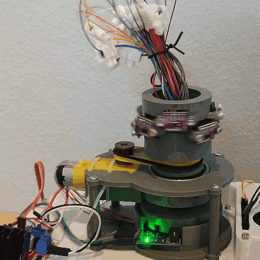
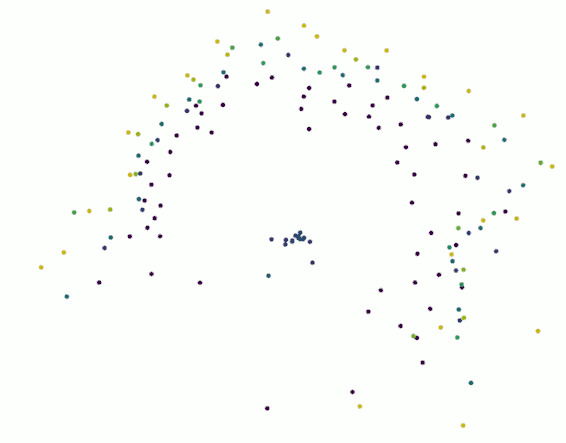
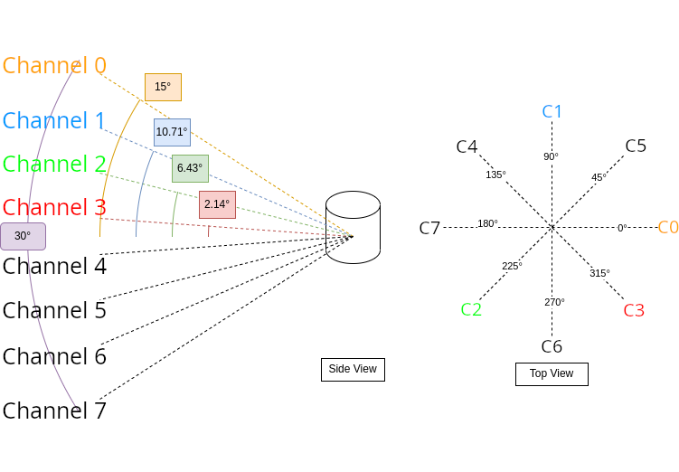
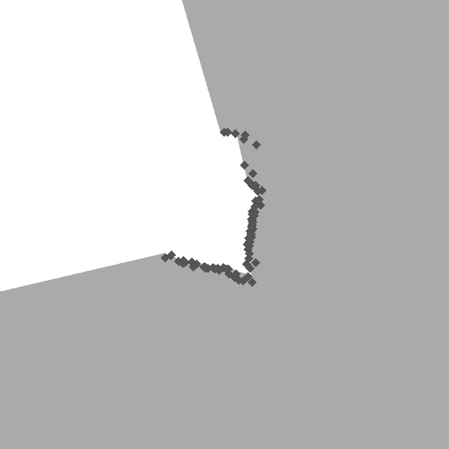

# Arduino 3D LiDAR: DIY 360° Scanner with VL53L0X Sensors

A low-cost, 3D-printed rotating LiDAR scanner built from eight **VL53L0X time-of-flight sensors**, an **Arduino Uno or ESP32**, and a slip ring. It sweeps a full 360° at about 2 Hz with a ±15° vertical field of view and streams the scan over USB serial. Python tools record the scans and show them as a 3D point cloud, live or from a recording.

It produces a coarse point cloud, suitable for experiments, teaching, and rough room-scale mapping. It does not replace a commercial LiDAR.

| Rotating sensor head | Point cloud playback (5× speed) |
| :---: | :---: |
|  |  |

## Contents

- [Specifications](#specifications)
- [How it works](#how-it-works)
- [Bill of materials](#bill-of-materials)
- [Build](#build)
- [Firmware](#firmware-arduino-uno-and-esp32)
- [Python tools](#python-tools-capture-and-visualize-point-clouds)
- [Data format and serial protocol](#data-format-and-serial-protocol)
- [Limitations](#limitations)
- [Related projects](#related-projects)

## Specifications

Measured on the bundled sample recording (`data/sequences/01`):

| | |
|---|---|
| Channels | 8 × VL53L0X, vertical angles evenly spaced from +15° to −15° |
| Horizontal coverage | 360°, rotating at a target of 2 Hz (500 ms per revolution, closed-loop) |
| Points per revolution | ~200 raw, ~140 with a valid return |
| Horizontal resolution | ~25 samples per channel per revolution (~14°) |
| Range of valid returns | 0.15–1.2 m for 90% of the sample's points; readings are clamped at 3 m |
| Angle reference | 15-tooth encoder disc with one gap for the zero position |
| Host link | USB serial, 115200 baud, 36-byte binary packets |
| Controllers | Arduino Uno (ATmega328P) or ESP32 (Arduino core 3.x) |

## How it works

Eight VL53L0X sensors sit on a rotating head, each tilted to a different elevation angle. A DC motor turns the head through a rubber-band drive, and a slip ring carries power and I²C through the rotating joint. An optical speed sensor reads a toothed encoder disc to measure the azimuth angle. A hardware timer interpolates the angle between teeth. The firmware also adjusts the motor PWM once per revolution to hold the speed at 2 Hz.

Each reading is a distance plus the azimuth and elevation of its channel. The Python tools convert these spherical coordinates to Cartesian XYZ.

|  |
| :---: |
| *Mounting angles of the eight sensor channels* |

Even at this resolution, the output works for simple tasks such as building an occupancy grid map:

|  |
| :---: |
| *Occupancy grid map built from the scanner's output (1× speed)* |

## Bill of materials

| Part | Qty | Notes |
|------|-----|-------|
| [VL53L0X breakout board](https://www.amazon.com/s?k=VL53L0X+breakout) | 8 | Must expose the `XSHUT` pin (used to assign I²C addresses) |
| [TT gear motor](https://www.amazon.com/s?k=TT+gear+motor+3-6V) | 1 | Yellow gearbox type, 3–6 V |
| [L298N motor driver](https://www.amazon.com/s?k=L298N+motor+driver) | 1 | Any H-bridge rated for your motor works |
| [Arduino Uno](https://www.amazon.com/s?k=Arduino+Uno) or [ESP32-WROOM dev board](https://www.amazon.com/s?k=ESP32+WROOM+dev+board) | 1 | Pick the matching firmware below |
| [12-wire slip ring](https://www.amazon.com/s?k=12+wire+slip+ring) | 1 | Carries power and signals to the rotating head |
| [6204-2RS deep-groove ball bearing](https://www.amazon.com/s?k=6204-2RS+bearing) | 1 | 20 × 47 × 14 mm (bore × OD × width), sealed both sides; supports the rotating head in the base top. The prototype uses an [LFD Wälzlager 6204 2RS](https://www.amazon.de/dp/B075W2R8M5); any 6204-2RS or 6204-ZZ fits |
| [LM393 speed sensor module](https://www.amazon.com/s?k=LM393+speed+sensor+module) | 1 | Reads the encoder disc |
| [M3 screw assortment](https://www.amazon.com/s?k=M3+screw+assortment) | 1 set | |
| Jumper wires, rubber band or O-ring | | Drive belt between motor gear and head |

Links are non-affiliate search links. Listings change too often to link specific products.

## Build

1. **Print the parts** in [`stl-files/`](stl-files/): base top and bottom, pillars, sensor head, encoder disc, and small gear. PLA at 0.2 mm layer height is fine.
2. **Assemble and wire** following [`stl-files/assembly-instructions.md`](stl-files/assembly-instructions.md). It covers print orientation, mechanical assembly, pin tables for both boards, and a pre-power checklist.

> [!CAUTION]
> The VL53L0X `XSHUT` pin is not 5 V tolerant. On an Arduino Uno, never drive it HIGH directly. The firmware only pulls it LOW or releases it as an input.

## Firmware (Arduino Uno and ESP32)

| Board | Sketch |
|-------|--------|
| Arduino Uno | [`arduino-code/write_byte_output_batchwise.ino`](arduino-code/write_byte_output_batchwise.ino) (bundles `TimerOne`) |
| ESP32 | [`esp32-code/write_byte_output_batchwise_esp32/`](esp32-code/write_byte_output_batchwise_esp32/) (ESP32 Arduino core 3.x timer API) |

1. Install the **VL53L0X library by Pololu**: *Sketch → Include Library → Manage Libraries…*, then search for `VL53L0X`.
2. Open the sketch for your board and upload it.
3. Power the motor driver from its own supply. USB alone cannot power both the motor and the board reliably, especially on the ESP32.

If the point cloud looks mirrored or smeared, the motor is probably spinning the wrong way. Swap the motor driver inputs `in1` and `in2`.

## Python tools: capture and visualize point clouds

The tools in [`python-receiver-code/`](python-receiver-code/) need Python 3.13+, and use [VisPy](https://vispy.org/) with a [GLFW](https://www.glfw.org/) window for rendering.

| Script | What it does |
|--------|--------------|
| `offline_visualization.py` | Plays back recorded `.npy` frames. Uses the bundled sample by default. |
| `receive_data.py` | Reads the serial stream and saves one `.npy` file per revolution |
| `live_visualization.py` | Shows the point cloud live from the serial stream. Can also save frames (`--save`). |

### Install

With [uv](https://docs.astral.sh/uv/) (recommended; it fetches Python 3.13 if needed):

```bash
uv sync
```

With pip:

```bash
python3.13 -m venv .venv
source .venv/bin/activate   # Windows: .venv\Scripts\activate
pip install .
```

### Run

Run the commands from the repository root. If you installed with pip, replace `uv run python` with `python` inside the activated environment.

Play back the bundled sample recording. You don't need the hardware for this:

```bash
uv run python python-receiver-code/offline_visualization.py
```

View a live scan from the scanner (use `COM3` or similar on Windows):

```bash
uv run python python-receiver-code/live_visualization.py --port /dev/ttyUSB0
```

Record scans to `data/sequences/<timestamp>/lidar_points/` without a viewer:

```bash
uv run python python-receiver-code/receive_data.py --port /dev/ttyUSB0
```

Useful options:

- `--path DIR_OR_FILE` (offline): play a different recording
- `--fps N` (offline): set the playback speed
- `--point-size PX`: set the size of the drawn points
- `--frame-limit N` (capture): stop after N revolutions
- `--keep-invalid` (viewers): also draw points with no return. By default, readings of 0 mm or clamped to 3000 mm are hidden, because they are not real surfaces.

Run any script with `--help` to see all options.

### Tests

```bash
uv run pytest
```

The tests check the packet parser, frame assembly, and coordinate conversion. They need no hardware and no OpenGL.

## Data format and serial protocol

**Recorded frames** are NumPy `.npy` files. Each file holds one revolution as an `(N, 3)` `int32` array of `distance_mm, azimuth_deg, channel`. Channel 0 is the top sensor at +15° and channel 7 the bottom one at −15°. The files store the raw sensor readings: the per-channel azimuth offsets and the conversion to XYZ are applied when the frames are loaded (`convert_to_cartesian` in `offline_visualization.py`).

**Serial packets** are 36 bytes:

```text
FE FD | 8 × [angle_hi angle_lo dist_hi dist_lo] | FC FB
```

All values are big-endian `uint16`. A packet whose 32-byte payload is all `0xFF` is a **sync packet**: the encoder has passed the zero position and a new revolution begins.

## Limitations

- **Sparse:** about 140 valid points per revolution. That's enough for occupancy maps, but not for detailed 3D reconstruction.
- **Short range:** the VL53L0X is specified to 2 m, and is often less in bright light or on dark surfaces.
- **Angle accuracy:** between encoder teeth, the angle is interpolated from a fixed timer that assumes exactly 2 Hz. Any speed change shows up as angular error.
- **No calibration workflow:** the channel offsets are hard-coded in `offline_visualization.py`.

## Related projects

- [OpenTOFLidar](https://github.com/iliasam/OpenTOFLidar): an open-source 2D time-of-flight LiDAR with much longer range, if you need range more than 3D coverage.

## License

[MIT](LICENSE) © Frederik Hasecke
